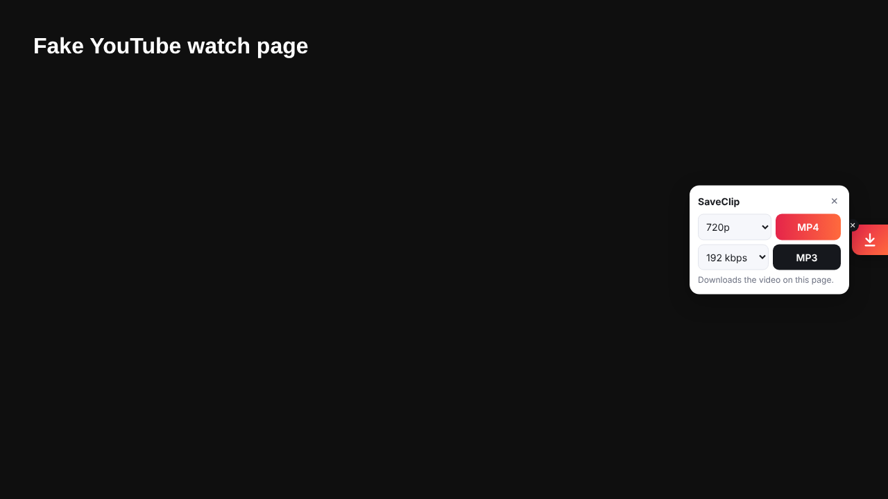

# SaveClip browser button (Chrome / Edge)

Adds a small red download button on the right side of YouTube, Instagram, Facebook,
X (Twitter), TikTok, Vimeo, SoundCloud, Dailymotion, Reddit and Twitch.
Tap it, choose **MP4** or **MP3**, and the file goes to your Downloads folder.

## Install (2 minutes)

1. Download this repo: on GitHub click **Code → Download ZIP**, then unzip it.
2. Open Chrome and go to `chrome://extensions` (Edge: `edge://extensions`).
3. Turn on **Developer mode** (top right).
4. Click **Load unpacked** and choose the **`extension`** folder.
5. Pin it: click the puzzle icon 🧩 in the toolbar, then the pin next to SaveClip.

## Connect it to your SaveClip server

Click the SaveClip icon in the toolbar and set **Server address**:

- SaveClip running on this computer (`start-windows.bat`): `http://127.0.0.1:8000` (the default)
- SaveClip online on Render: your link, for example `https://saveclip.onrender.com`

Click **Save**, then **Test**. It should say "Server is working ✅".

## Use it

1. Open a video or post (the post itself, not the home feed).
2. Click the red ⬇ button on the right side.
3. Pick a quality and click **MP4** or **MP3**. Chrome shows the download when it's ready
   (longer videos take a minute while the server prepares them).

Hover the button and click the small ✕ to hide it on that page.

Only download content you own or have permission to use.
